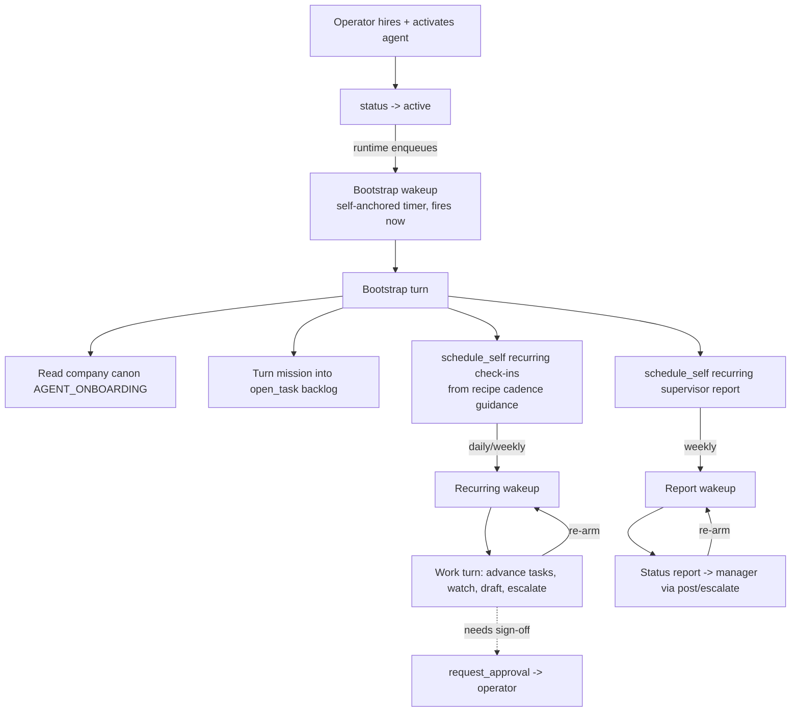

# Pidgin Autonomy Spec

## Summary

```text
A hired agent runs the company without being switched on by hand. When it becomes
active it wakes itself, reads the company context, turns its recipe's mission into a
standing task backlog, and schedules its own recurring check-ins. From then on it is
driven by its own timers, its task list, and periodic status reports to its supervisor
— not by a human poking it. The operator sets direction and approves; the agent keeps
itself busy.
```

> **Scope:** The layer that turns a *reactive* agent (acts only when addressed) into a
> *self-running* one (defines its own work, schedules itself, reports up). Covers
> activation bootstrap, recurring schedules, self-anchored timers, a wakeup budget, the
> task backlog, and the supervisor check-in loop.
>
> **Pairs with:** [AGENT_RUNTIME_SPEC.md](AGENT_RUNTIME_SPEC.md) (triggers, actions,
> turn lifecycle, sense of time), [SCHEMA_SPEC.md](SCHEMA_SPEC.md) (the tables below
> already exist), [SECURITY_SPEC.md](SECURITY_SPEC.md) (trust labels, the gate),
> [AGENT_ONBOARDING.md](AGENT_ONBOARDING.md) (first-read of company canon),
> [RECIPES_SPEC.md](RECIPES_SPEC.md) (recipe fields).
>
> **Out of scope:** Connector-side watcher delivery (trigger 5 plumbing), multi-agent
> org charts beyond a single manager edge, SLA/business-hours math (see
> [AGENT_RUNTIME_SPEC §4.4](AGENT_RUNTIME_SPEC.md)).

---

## 1. Why this exists

Today the runtime spine is complete but one-directional. Every trigger becomes an
`inbound_events` row and a background worker ([worker.py](../src/pidgin/runtime/worker.py))
dispatches turns from that queue. The timer path works end to end: `schedule_self` →
`agent_timers` → `fire_due_timers` → `inbound_events` → turn
([scheduler.py](../src/pidgin/runtime/scheduler.py),
[timers.py](../src/pidgin/db/timers.py)).

But an agent only ever runs if a human speaks to it first, and a "schedule" lasts exactly
one wakeup. Four things are missing for a company to run itself:

| # | Gap | Today | Consequence |
|---|-----|-------|-------------|
| 1 | **Cold start** | Every timer requires an `originating_turn_id`; nothing runs a turn on activation | A freshly hired agent is inert until a human DMs it — manual activation |
| 2 | **Recurrence** | `agent_timers` goes `pending → fired` once; `schedule_self` takes only `delay_minutes` | "Every morning" must be re-armed each time and dies silently if one tick fails |
| 3 | **Backlog** | `tasks` table exists; `open_task`/`close` are in the enum but unimplemented and unexposed | Agent can't hold what it's responsible for across turns |
| 4 | **Reporting up** | `manager_principal_id` exists; `escalate` unimplemented | No "check with my supervisor weekly" mechanism |

This spec closes all four. The schema needs only additive columns — every table already
exists.

---

## 2. The model in one picture



The keystone is the **bootstrap wakeup**: it removes manual activation and lets the agent
set up *its own* cadence on day one, rather than the runtime hard-coding it.

---

## 3. Self-anchored timers (closes gap 1, enables everything)

Today `agent_timers.originating_turn_id` is `NOT NULL` and `fire_due_timers` copies the
origin conversation onto the fired event so a reply lands where it was requested. A
self-running agent needs timers that belong to *no* conversation — the agent's own
calendar, not a follow-up to someone.

**Change:** make `originating_turn_id` nullable. A timer with a null origin is
**self-anchored**: when it fires, the resulting turn has no conversation to `say` into, so
the agent must use `post`/`escalate`/`open_task` to produce visible effects (the egress
already falls back to `NullEgress` when there's no `conversation_id` —
[actions/__init__.py](../src/pidgin/runtime/actions/__init__.py)).

**Trust label on self-anchored timers:**

- **Bootstrap & runtime-armed timers** → `internal-authenticated`. They originate from the
  operator's act of activating the agent, on the agent's own behalf. This is the only place
  the runtime mints trust without an upstream event; it is safe because it carries no
  external content.
- **Agent-armed recurring timers** → inherit the trust label of the turn that called
  `schedule_self`, exactly as today ([SECURITY_SPEC §10](SECURITY_SPEC.md), runtime spec
  §6.1). A timer set inside an `untrusted-content` turn stays untrusted forever.

---

## 4. Activation bootstrap (closes gap 1)

When an agent transitions to `active` (`transition_employee_status` in
[employees.py](../src/pidgin/db/employees.py)), the runtime enqueues a **bootstrap timer**:
a self-anchored timer scheduled at `now`, trust `internal-authenticated`, with a fixed
`reason` of kind `bootstrap`. It fires on the next worker tick like any other timer.

The bootstrap turn's injected message instructs the agent to:

1. **Read company canon first** ([AGENT_ONBOARDING.md](AGENT_ONBOARDING.md) §2) and cache
   the role-relevant parts via `remember`.
2. **Decompose its mission into tasks** — read its recipe `mission` /
   `responsibilities` and `open_task` one durable task per standing responsibility.
3. **Schedule its own recurring check-ins** from the recipe's cadence guidance (§8), via
   recurring `schedule_self`.
4. **Schedule a recurring status report** to its supervisor (§9).
5. Optionally `escalate` to the operator any blocking gap (missing connector, unclear
   scope) before going quiet.

**Idempotency.** Bootstrap must run **once per activation, not once per `active` write**.
Track it with an `ai_employees.bootstrapped_at` marker (additive column):
- Null → bootstrap timer is enqueued on the transition to `active`; stamp on completion.
- Re-activating from `paused` does **not** re-bootstrap (the backlog and timers survive);
  it instead enqueues a lighter **resume** wakeup ("you were paused; here's your backlog —
  re-arm anything that expired").

This mirrors the onboarding "read-once-then-cache" lifecycle and the spec's open item
*"first-read bootstrap — runtime ensures a new agent's first action reads the onboarding
doc."* Bootstrap is that hook.

> **Trigger vocabulary.** Bootstrap reuses **trigger 4 (timer)** — it is just the agent's
> first self-anchored timer — so the "8 triggers, nothing else starts a turn" invariant in
> [AGENT_RUNTIME_SPEC §2](AGENT_RUNTIME_SPEC.md) holds. The `bootstrap` kind lives in the
> timer's payload, not as a 9th trigger type.

---

## 5. Recurring schedules (closes gap 2)

`schedule_self` gains an optional recurrence; cadence is the **agent's** choice, guided by
the recipe (§8), per the product decision.

**`schedule_self` params (extended):**

| Param | Today | New |
|-------|-------|-----|
| `delay_minutes` | required | optional (one-shot, unchanged) |
| `reason` | required | required |
| `recurrence` | — | optional: `{ "kind": "daily"|"weekly"|"interval", ... }` |
| `at_local_time` | — | optional `"HH:MM"` for daily/weekly anchoring |

`recurrence` shapes (RRULE-lite — deliberately small, per runtime spec §4.4's "no full
cron"):

```json
{ "kind": "daily",    "at_local_time": "09:00" }
{ "kind": "weekly",   "weekday": "mon", "at_local_time": "08:30" }
{ "kind": "interval", "every_minutes": 240 }
```

**Schema (additive on `agent_timers`):** `recurrence_json TEXT NULL`, `next_run_at TEXT
NULL`, and a `kind TEXT NOT NULL DEFAULT 'oneshot'` discriminator
(`oneshot`|`recurring`|`bootstrap`).

**Re-arm semantics.** In `fire_due_timers`, after a timer fires:
- `oneshot`/`bootstrap` → mark `fired` (terminal, as today).
- `recurring` → compute the next occurrence from `recurrence_json`, set `scheduled_at =
  next_run_at`, keep `status = 'pending'`. A missed window advances to the *next future*
  occurrence (no thundering catch-up of every skipped tick).

**Cancellation** stays gated like any action ([runtime spec §6.1.3](AGENT_RUNTIME_SPEC.md));
a `cancel_schedule(timer_id)` action lets an agent retire a cadence it no longer needs.

---

## 6. Wakeup budget (safety for self-running)

Self-running + recurrence + bootstrap means agents now wake without a human in the loop —
so a runaway recipe or an injection-induced loop must be capped. Enforce the runtime spec's
[Open Decision 4](AGENT_RUNTIME_SPEC.md) defaults:

| Limit | Default | Enforced in |
|-------|---------|-------------|
| `max_pending_timers` | 50 | `schedule_self` — refuse beyond cap |
| `max_wakeups_per_day` | 100 | `fire_due_timers` — count timer-fired turns per agent per UTC day; over cap → defer + one `escalate` to the operator, don't silently drop |

Both are recipe-overridable (`autonomy.limits` in §8). Crossing a cap is an **audited**
event, surfaced in diagnostics — not a silent stall.

---

## 7. Task backlog (closes gap 3)

The `tasks` table and `tasks_status_log` already exist with `owner_principal_id`,
`current_status` (`open`/`in_progress`/`blocked`/`done`/`cancelled`), `outcome`, `due_at`,
and `source_turn_id`. Two actions in the enum just need wiring:

- **`open_task`** → insert a `tasks` row owned by the agent's principal, linked to the
  current turn. Always allowed (runtime spec §3).
- **`close`** → transition a task to `done`/`cancelled` with an `outcome`. Always allowed.
- (Status moves `open → in_progress → blocked` use the same close/update path.)

**Backlog injection.** Each turn injects the agent's open tasks alongside its pending
timers and watchers — the "My open tasks" block, extending the sense-of-time injection of
[AGENT_RUNTIME_SPEC §4.3](AGENT_RUNTIME_SPEC.md) (currently `prompt.py` injects only
`now`). This is what lets a recurring "work" wakeup pick up where the last one left off
instead of re-deriving its job:

```text
My open tasks:
  [in_progress] Draft April newsletter        (due Fri, opened 3 days ago)
  [blocked]     Q2 ad budget — waiting on operator approval
  [open]        Refresh competitor scan
```

A standing responsibility = a long-lived task; a recurring timer = the heartbeat that says
"go advance these now."

---

## 8. Cadence from recipe guidance (the agent picks)

Recipes gain an optional **`autonomy`** block. It is *guidance in natural language plus
soft defaults* — the bootstrap turn reads it and decides its actual schedule, rather than
the runtime arming fixed cron jobs. This keeps "I don't want to activate them manually"
true at the cadence level too: the agent owns its calendar.

```json
"autonomy": {
  "cadence_guidance": [
    "Review the content pipeline and any in-flight campaigns each morning.",
    "Scan competitor activity weekly.",
    "Send the operator a short status report every Friday."
  ],
  "supervisor_report": { "cadence": "weekly", "weekday": "fri" },
  "limits": { "max_wakeups_per_day": 60 }
}
```

- `cadence_guidance` → injected into the bootstrap prompt; the agent converts each line
  into `open_task` + recurring `schedule_self` as it sees fit.
- `supervisor_report` → seeds §9; the agent may tune timing but should not drop it.
- `limits` → overrides §6 defaults.

Absent an `autonomy` block, the bootstrap prompt falls back to a generic instruction
("establish a daily review of your responsibilities and a weekly report to your
supervisor"), so every agent still self-runs.

---

## 9. Supervisor check-in loop (closes gap 4)

Every agent has a `manager_principal_id` (its human owner by default, or another agent's
principal). Autonomy adds a **standing reporting obligation**:

1. During bootstrap the agent schedules a **recurring report timer** (from
   `autonomy.supervisor_report`, default weekly).
2. On fire, the agent assembles a report from `recall` + its open `tasks` (what shipped,
   what's in flight, what's blocked, what it needs a decision on) and sends it **up** via:
   - **`escalate`** when it needs a decision or is blocked — hands work to the
     owner/manager with context (runtime spec action 13), routed to that principal.
   - **`post`** to the manager's channel/DM for an informational digest needing no action.
3. Anything requiring sign-off remains a **`request_approval`** to the operator — the
   report surfaces it, the approval gate decides it ([runtime spec §8](AGENT_RUNTIME_SPEC.md)).

**`escalate` implementation:** resolve `manager_principal_id` → that principal's
DM/conversation, write the handoff with full context (originating task, the tradeoff, the
recommendation), and link the source task. It is the mirror of `delegate` (down) — same
authority-chain rules ([SECURITY_SPEC §10](SECURITY_SPEC.md)): escalation does not launder
trust.

This gives a manager (human *or* a lead agent) a real org: leads get periodic reports from
reports and can `delegate` back down, all on the same primitives.

---

## 10. Build order

Each slice is shippable and observable on its own.

| Slice | Delivers | Touches |
|-------|----------|---------|
| **A — Self-anchored timers** | Timers with no conversation; trust rules | migration (nullable `originating_turn_id`), `timers.py`, `fire_due_timers` |
| **B — Activation bootstrap** | Agents wake themselves on activate; first-read; idempotent marker | `bootstrapped_at` column, hook in `transition_employee_status`, bootstrap prompt |
| **C — Recurring schedules** | Daily/weekly/interval that survive missed ticks | `recurrence_json`/`next_run_at`/`kind` columns, re-arm in `fire_due_timers`, extend `schedule_self` + tool def |
| **D — Wakeup budget** | Caps + audited cap-crossing | counters in `schedule_self` / `fire_due_timers`, recipe `limits` |
| **E — Task backlog** | `open_task`/`close` wired + injected into prompt | `execute_action`, tool defs, `prompt.py` injection, `tasks` reads |
| **F — Supervisor loop** | `escalate` wired + recurring report pattern | `execute_action` (`escalate`), bootstrap seeds report timer, recipe `autonomy` block |

A→C alone make agents self-running; E and F make them *manageable* (a backlog you can see,
reports you receive). Recipes (`marketing-agent`, `support-agent`, …) get an `autonomy`
block as part of F.

---

## 11. Safety summary

| Concern | Mitigation |
|---------|------------|
| Runaway self-prompting | §6 budget; audited cap-crossing; cap on pending timers |
| Trust escalation via timers | §3 — agent-armed timers inherit trust; only runtime-armed bootstrap mints `internal-authenticated`, and it carries no external content |
| Injection-driven autonomy | Gate unchanged ([runtime spec §8](AGENT_RUNTIME_SPEC.md)); a `untrusted-content` turn can't originate `post`/`execute`; its self-prompts stay untrusted |
| Double bootstrap | §4 `bootstrapped_at` marker; pause→active resumes, doesn't re-bootstrap |
| Silent failure | Every cap, refusal, and missed cadence is an `agent_action_log` row → diagnostics; no silent drop |

---

## 12. Open decisions

| # | Decision | Status |
|---|----------|--------|
| 1 | Recurrence expressivity — RRULE-lite (§5) vs. full cron strings | Lean RRULE-lite for MVP; cron later if needed |
| 2 | Timezone for `at_local_time` — workspace tz vs. operator tz | TBD; default workspace setting, fall back to UTC |
| 3 | Report transport when manager is another agent — `post` to a DM conversation vs. `delegate`-style event | Lean `post`; revisit when lead-agent orgs are real |
| 4 | Does bootstrap *gate* on company-canon existence, or proceed and flag the gap? | Lean proceed + `escalate` the gap, per AGENT_ONBOARDING open decision 4 |
| 5 | Catch-up policy for long-paused recurring timers | §5 says skip to next future occurrence; confirm no digest-of-missed needed |
