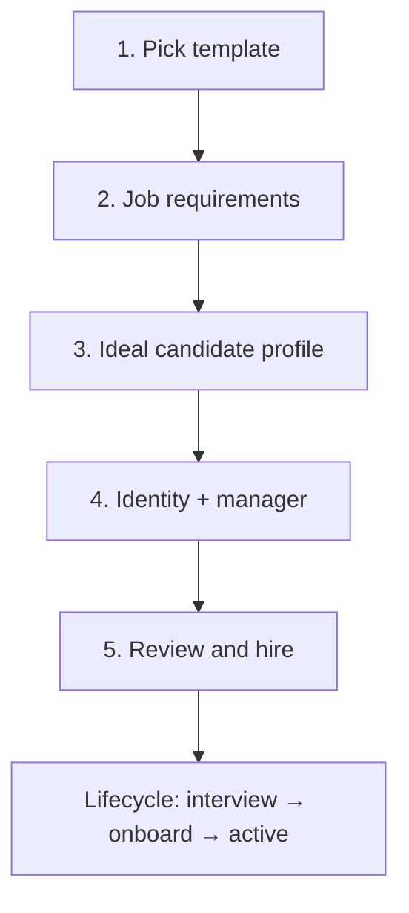
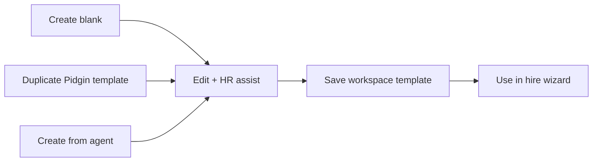

# Hire UX — vocabulary, flows, templates, HR assist

Product-owned UX spec for the hire sequence. Internal engineering may still use **role recipe** / **recipe snapshot** in code and [RECIPES_SPEC.md](RECIPES_SPEC.md); **never** expose “recipe” in operator UI.

**Related:** [PRODUCT_SPEC.md](PRODUCT_SPEC.md) §Flow 2, [MVP_USER_STORIES.md](MVP_USER_STORIES.md) US-6–US-11.

---

## 1. User-facing vocabulary (Naming A — locked)

| Internal | UI label |
|----------|----------|
| Role recipe (bundled) | **Candidate profile** (page header "Hire a role"; section "Candidate Profiles") |
| Workspace-saved template | **Your saved profile** |
| Recipe library | **Hire a role** |
| Job definition fields | **Job requirements** |
| Prompt / behavioral fields | **Ideal candidate profile** |
| Operator freeform additions | **Your take** |
| Permissions | **Access & approvals** |
| Recipe snapshot on employee | Shown as “Based on *{template name}* v{version}” |

---

## 2. Template sources and storage

| Source | Scope | Storage | Editable by operator |
|--------|-------|---------|----------------------|
| **Pidgin role templates** | Shipped in repo | `recipes/*.json` (versioned semver) | No — duplicate into workspace template to edit |
| **Your role templates** | Per workspace | **Text files** under workspace dir (see §2.1) | Yes — create, edit, save new version, delete |
| **Agent → template** | Created from hired agent | New workspace template file | Does not modify source agent |

All workspace template creates and edits **must persist** to disk (no ephemeral-only drafts). Auto-save on field blur or explicit **Save template** — implementer chooses; operator must never lose work on navigation away.

### 2.1 Workspace template files (locked — no DB)

**Your role templates** live as text files inside the workspace directory, not in SQLite.

Layout ([SCHEMA_SPEC.md](SCHEMA_SPEC.md) §4.1.1):

```
~/.pidgin/workspaces/<id>/
  role-templates/
    <template-slug>/
      manifest.json          # name, slug, current_version, created_at, updated_at, optional lineage
      v1.md                    # Markdown + YAML frontmatter (locked format)
      v2.md
      ...
```

- **Format (locked):** Markdown with YAML frontmatter — human-readable role brief sections (Job requirements, Ideal candidate profile, Your take).
- **Versioning:** Each save under the **same template slug** appends a new version file (`v1` → `v2` → …). UI shows latest as current; older versions remain browsable. Prior version files are **never overwritten**.
- **Same name, new version:** Operator may keep the display name unchanged; saving promotes **latest version** in `manifest.current_version`.
- **Pidgin role templates** remain bundled JSON with semver (`0.1.0`, `0.2.0`); duplicating into workspace starts at `v1.md` for that workspace copy.

Hire still creates an immutable **snapshot** on the employee row at hire time (existing `ai_employee_recipe_snapshots`); workspace template files are the editable library, not the runtime snapshot.

---

## 3. Hire wizard



Steps 2–3 include the **Pidgin HR assist** chat panel (§5).

**Step 1 — Pick a candidate (the marketplace)**

- Sections: **Candidate Profiles** (bundled) + **Your saved profiles** (workspace).
- Toolbar above the grid: **search** (filters by name / role / description), **Show archived
  profiles** toggle, and a **candidate-finder chat** ("Ask HR to help you find the right candidate")
  — HR recommends candidates from the catalog and links straight to their profiles. Backed by the
  pre-hired HR agent on a real LLM backend; keyword match as the offline fallback.
- Each candidate links to a **candidate profile page** (`hire/candidates/{template_id}`) — a
  read-about-this-AI page showing mission, responsibilities, out-of-scope, ideal candidate profile,
  and access & approvals, with **Hire {name}** (deep-links via `hire?template={id}`, preselecting the
  candidate and jumping to details) and **Duplicate to your templates**.
- Card descriptions are clamped to two lines; full text lives on the profile page.
- Card actions: **Use this profile** | **Duplicate** | **Read full profile →** | **Archive / Unarchive**.
- **Archive** is a per-workspace hide flag (bundled profiles ship read-only, so archive ≠ delete),
  stored in `marketplace/archived.json`; archived profiles appear only when **Show archived** is on.

**Steps 2–3 — Editable brief**

- Pre-filled from template defaults
- Fields: see [MVP_USER_STORIES.md](MVP_USER_STORIES.md) US-6
- HR assist panel always visible

**Step 4 — Identity**

- Agent display name, handle, manager (default: logged-in user)

**Step 5 — Review**

- Summarize template source, job requirements, ideal candidate, your take, identity
- CTA: **Hire and continue**

---

## 4. Agent profile (post-hire)

Route: `/{workspace}/agents/{handle}`

| Section | Behavior |
|---------|----------|
| Status + lifecycle CTAs | draft → interviewing → onboarding → active |
| Job requirements | **Editable**; save persists + audit |
| Ideal candidate profile | **Editable**; save persists + audit |
| Your take | **Editable** |
| Access & approvals | Read-only summary in MVP (overrides UI later) |
| Template lineage | “Based on Support Agent template v0.1” |
| **Create template from this agent** | Copies brief + permissions posture into new **Your role template** |
| HR assist | Same chat panel as hire wizard |

Post-hire edits update `hire_customization_json` on the employee row and append to `audit/brief-edits/<employee_id>.jsonl` — they do **not** mutate the immutable hire-time snapshot. See [SCHEMA_SPEC.md](SCHEMA_SPEC.md) §7.1, §4.1.3.

---

## 5. Pidgin HR assist

The hiring coach is the **pre-hired HR agent** (`hr-onboarding` recipe), seeded as a workspace
singleton at workspace creation (handle `@hr`). The same agent both coaches hiring and stewards the
onboarding doc (§AGENT_ONBOARDING). The chat panel renders its persona; suggestions come from the
agent, not a hardcoded script.

> Reverses the original MVP rule ("*not* a hired AI employee"). A keyword **stub** remains as the
> offline fallback so the panel still answers and **hiring never blocks** when the LLM backend is
> `stub` or unavailable.

| Property | Rule |
|----------|------|
| Backed by | Pre-hired HR agent (`@hr`, singleton); keyword stub is the fallback only |
| Surfaces | Hire wizard (steps 2–3), agent profile edit, custom template editor |
| UI | Split layout: form left, **Discuss with Pidgin** chat right (collapsible on mobile) |
| Persona | HR / hiring advisor: clarifies role scope, tightens ideal candidate wording, flags gaps |
| Context | The current draft brief is sent with each message so the coach reasons over real values |
| Apply flow | Agent emits a `pidgin-suggestion` block → **Apply to form** (targeted fields) or **Append to your take** |
| Persistence | Chat thread saved per context (`hire_session_id`, `agent_id`, or `template_id`) |
| Runtime | Real backend → agent persona reply; `stub` backend or any failure → keyword fallback; never blocks save/hire |

**Out of scope for assist:** changing access & approvals without explicit operator action; auto-hire without review step.

---

## 6. Create template from agent

**Trigger:** Agent profile → **Create template from this agent**

**Copies:**

- Job requirements, ideal candidate profile, your take (current values)
- Access & approvals summary (as template defaults)
- Source lineage note: “Derived from @{handle}”

**Does not copy:** agent display name, handle, manager, status, interview/onboarding progress.

**Result:** New **Your role template** opens in editor; operator names it and saves.

---

## 7. Custom template lifecycle



- **Create blank:** empty job requirements + ideal candidate; operator fills with HR assist
- **Duplicate Pidgin template:** creates editable workspace copy; Pidgin original unchanged
- **Delete:** workspace templates only; confirm if template was used for hires (show hire count)

---

## 8. Architect handoffs — resolved (PID-6)

| Topic | Resolution |
|-------|------------|
| `hire_customization_json` + prompt merge | [SCHEMA_SPEC.md](SCHEMA_SPEC.md) §7.1 (JSON shape), §7.2 (turn-time merge with snapshot `system_prompt_template`); migration `002_hire_customization` in §15.1 |
| Workspace template file layout + API | [SCHEMA_SPEC.md](SCHEMA_SPEC.md) §4.1.1; routes in [IMPLEMENTATION_PLAN.md](IMPLEMENTATION_PLAN.md) Hire UX API table |
| Version promotion (same slug → new `v<N>.md`) | §4.1.1 — manifest `current_version` bumped; prior files retained |
| HR assist session storage + messages API | [SCHEMA_SPEC.md](SCHEMA_SPEC.md) §4.1.2 (`hr-assist/sessions/<ulid>/`); routes in [IMPLEMENTATION_PLAN.md](IMPLEMENTATION_PLAN.md) |
| Suggestion payload (Apply / Append) | §4.1.2 — `suggestion.action`: `apply` \| `append_your_take` |
| Audit: post-hire brief edits + template version creates | [SCHEMA_SPEC.md](SCHEMA_SPEC.md) §4.1.3 — `audit/brief-edits/`, `audit/template-versions/` JSONL |
| Bundled `default_job_requirements` / `default_ideal_candidate` | [RECIPES_SPEC.md](RECIPES_SPEC.md) §2.1 |

**Implementation phases:** [IMPLEMENTATION_PLAN.md](IMPLEMENTATION_PLAN.md) Phase 1B (hire wizard), 1B2 (workspace templates), 1B3 (post-hire edit), 1C (HR assist).

---

## 9. Phased delivery

| Slice | Delivers |
|-------|----------|
| B | Hire wizard + Pidgin templates + customization persist at hire |
| B2 | Workspace templates CRUD + create from agent |
| B3 | Post-hire edit + audit |
| C | HR assist chat (stub LLM) |
| D | Interview scenarios |
| E | Onboarding + activate |
