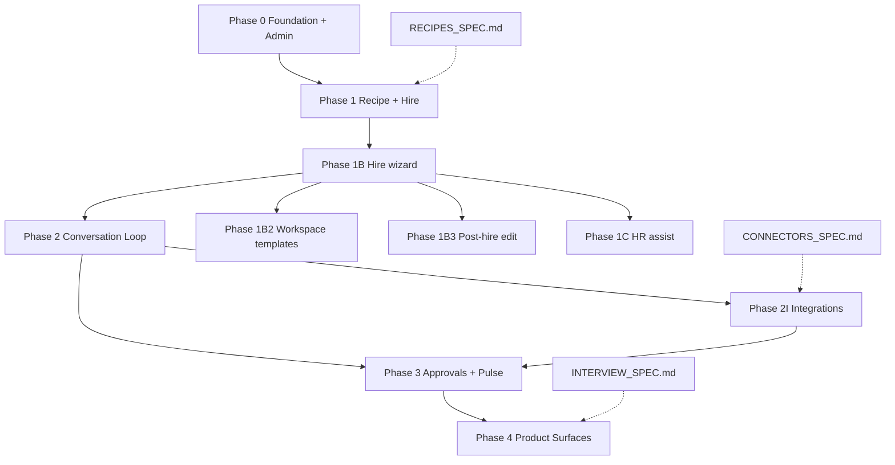

# Pidgin Implementation Plan

Handoff document for building the MVP incrementally. Each phase should land with passing tests before the next begins.

**North star** (from [PRODUCT_SPEC.md](PRODUCT_SPEC.md)):

> Founder picks SaaS hierarchy recipe → hires Support Agent → interview → onboard → text chat → task with approval → "what happened today."

---

## Operator model (locked)

| Surface | Role |
|---|---|
| **Admin UI + API** | **Only** MVP operator path — create workspace, hire, chat, diagnostics |
| **Human test loop** | Every feature must be exercisable from the admin screen before moving on |

**Not in MVP:** No Typer CLI. `src/pidgin/cli.py` and the `pidgin` console script are removed — do not reintroduce CLI commands or document CLI as an operator path.

Run the admin server:

```bash
uv sync --extra dev --extra api
uv run pidgin-admin --home ~/.pidgin
# → http://127.0.0.1:8765/
```

---

## How to use this doc (for agents)

1. Read [README.md](README.md) for locked decisions — do not re-litigate them.
2. Pick **one phase task** (or a clearly scoped sub-task) and mark it in your PR/commit message.
3. Align with existing specs — especially [AGENT_RUNTIME_SPEC.md](AGENT_RUNTIME_SPEC.md), [SCHEMA_SPEC.md](SCHEMA_SPEC.md), [SECURITY_SPEC.md](SECURITY_SPEC.md).
4. Run verification before finishing:
   ```bash
   uv sync --extra dev --extra api
   uv run pytest -v
   uv run ruff check src tests
   ```
5. Do **not** invent recipe format, gate semantics, or table shapes — extend what exists.
6. **Diagnostics-first:** ship read views and admin commands before adding automation; verify manually in `/admin`.

---

## Current status

| Area | Status | Notes |
|---|---|---|
| Specs (product, runtime, schema, stack, security) | ✅ Done | See [README.md](README.md) |
| `migrations/001_initial.sql` (26 tables) | ✅ Done | FK constraints omitted; app enforces integrity |
| `pyproject.toml` + package layout | ✅ Done | Python 3.12+ |
| Core types (`src/pidgin/types/`) | ✅ Done | 8 triggers, 14 actions, gate I/O |
| Workspace lifecycle (`src/pidgin/workspace/`) | ✅ Done | create/open, bcrypt `auth.json`, registry |
| DB layer (`src/pidgin/db/`) | ✅ Done | migrate, connect, event insert/fetch, diagnostics queries |
| File knowledge (`src/pidgin/knowledge/`) | ✅ Done | `remember` / `recall_tail` / `recall_grep` |
| Policy gate (`src/pidgin/gate/`) | ⏸ Deferred | Security last in MVP; chat turns bypass gate |
| Runtime (`src/pidgin/runtime/`) | 🟡 Chat stub | Event → turn → stub reply via `say`; no LLM API yet |
| Recipe loader + hire (`src/pidgin/recipes/`, `hire/`) | ✅ Done | Bundled support-agent-v0.1.json |
| Product UI (home + chat) | ✅ Done | Hire → #support chat with stub replies |
| Services (`src/pidgin/services/`) | ✅ Done | Workspace create/list; inject event; run-once |
| Admin API + UI (`src/pidgin/api/`) | ✅ Done | FastAPI + HTML admin; diagnostics routes |
| Tests | 🟡 Partial | Foundation + admin + product flow tests |
| `recipes/support-agent-v0.1.json` | 🟡 Stub | No schema validation yet |
| `MVP_USER_STORIES.md` | 🟡 Updating | US-1–US-3 now reference admin UI |
| `RECIPES_SPEC.md` | ✅ Done | Bundle schema + `default_job_requirements` / `default_ideal_candidate` (PID-6) |
| `HIRE_UX.md` | ✅ Done | Wizard UX; architect handoffs resolved in §8 |
| Hire UX storage (SCHEMA_SPEC §4.1) | ✅ Spec'd | `role-templates/`, `hr-assist/`, `audit/` file layout locked |
| `migrations/002_hire_customization.sql` | ❌ Missing | Adds `hire_customization_json` — backend dev (PID-7) |
| `src/pidgin/llm/` | ❌ Missing | Phase 2 |
| Repository helpers (status-log, append-only guard) | ❌ Missing | Phase 0.5 |

**Next agent should:** implement Phase 1B hire wizard backend (PID-7) — migration 002, `hire_customization_json`, role-template file I/O, hire API extensions. Frontend hire UX (PID-8) follows. **Do not** prioritize gate matrix work.

### MVP priority order

1. **Visible product** — hire, chat, rooms, agent roster (in progress)
2. **Real LLM** — replace stub replies
3. **Tasks + approvals** — product flows
4. **Security / gate** — last

---

## Locked constraints (do not change without explicit user approval)

| Decision | Value |
|---|---|
| Language | Python 3.12+ |
| Operator surface | Admin UI + backend API only — **no CLI in MVP** |
| Storage | One workspace = one directory: `db.sqlite` + `memory/`, `docs/`, `blobs/` |
| DB scope | Per-workspace SQLite; no `workspace_id` columns |
| Password | Supplied via admin unlock / API session; bcrypt hash in `auth.json` only; no OS keychain |
| Memory | File-based `memory/<handle>/journal.md`; recall = tail + grep |
| MVP omissions | No CLI; no vectors, SQLCipher, Argon2, AES credential encryption |
| Gate | Runs **outside** LLM; every decision → `agent_action_log` row — **deferred to post-MVP** |
| Recipes | Separate marketplace app; runtime uses snapshot at hire time |
| Verification | Human-testable via admin UI before phase exit |

---

## Phases

### Phase 0 — Foundation + Admin shell

**Goal:** Workspace on disk, schema applied, event queue + turn stub, **admin UI with diagnostics and commands**.

| ID | Task | Primary files | Done when |
|---|---|---|---|
| 0.1 | Repo scaffold | `pyproject.toml`, `src/pidgin/` | `uv sync --extra dev --extra api` succeeds |
| 0.2 | Core Pydantic types | `src/pidgin/types/` | All 8 triggers + 14 actions as enums; gate I/O models |
| 0.3 | Workspace lifecycle | `src/pidgin/workspace/manager.py` | create/open; `auth.json` bcrypt; registry JSON |
| 0.4 | DB migration | `migrations/001_initial.sql`, `src/pidgin/db/connection.py` | `apply_migrations` idempotent; 26 tables |
| 0.5 | Repository helpers | `src/pidgin/db/` (new modules) | ULID/timestamp helpers; status-log insert helper; append-only guard for audit tables |
| 0.6 | File knowledge | `src/pidgin/knowledge/memory.py` | Append journal; tail + grep recall |
| 0.7 | Policy gate | `src/pidgin/gate/policy.py` | **Post-MVP** — skeleton exists; do not block product work |
| 0.8 | Event → turn stub | `src/pidgin/db/events.py`, `src/pidgin/runtime/` | Pending event → `turns` row → `agent_action_log` → event `done` |
| 0.9 | **Admin server** | `src/pidgin/api/`, `src/pidgin/services/` | `pidgin-admin`; create workspace; unlock; inject event; run-once |
| 0.10 | **Diagnostics views** | `src/pidgin/db/diagnostics.py`, `api/routes/` | Events, turns, turn timeline, audit — UI + JSON API |
| 0.11 | Foundation tests | `tests/test_foundation.py`, `tests/test_admin_api.py` | All green; admin human loop covered |

**Phase 0 exit criteria**

- [ ] `uv run pytest -v` passes
- [ ] Admin UI: create workspace → unlock → hire agent → chat in `#support`
- [ ] Diagnostics (Tools → Diagnostics): inject test event → run once → see event `done`, turn, audit row
- [ ] Diagnostics API returns same data as UI tables (`/api/workspaces/{id}/turns`, `/audit`)

**Known Phase 0 gaps to close**

- Phase 0.5 repository helpers
- Split tests into `tests/unit/` and `tests/integration/` per layout below

**Deferred (not MVP exit criteria)**

- Gate matrix tests and wiring `gate()` into turn executor
- CLI — removed; not shipped

**Human test script (run after every Phase 0 change)**

1. `uv run pidgin-admin --home /tmp/pidgin-test`
2. Open http://127.0.0.1:8765/admin
3. Create workspace "Test" with password `pw`
4. Hire Support Agent → send a chat message → see agent reply
5. Optional: Diagnostics → inject test event → run once → inspect turn timeline

---

### Phase 1 — Stub recipe + hire

**Goal:** Hire one Support Agent from a bundled recipe snapshot. **Hire via admin UI only.**

| ID | Task | Primary files | Done when |
|---|---|---|---|
| 1.1 | Recipe spec | `specs/RECIPES_SPEC.md` | Documents bundle fields, validation rules, snapshot immutability |
| 1.2 | Stub recipe | `recipes/support-agent-v0.1.json` | Validates against spec; includes permissions + prompt template |
| 1.3 | Recipe loader | `src/pidgin/recipes/` | Load JSON, compute `bundle_sha256`, validate schema |
| 1.4 | Hire flow | `src/pidgin/hire/` | Creates `ai_employees`, `principals`, `ai_employee_recipe_snapshots` |
| 1.5 | Permission resolution | `src/pidgin/gate/` | **Post-MVP** — merge recipe permissions when gate lands |
| 1.6 | **Admin hire** | `src/pidgin/api/routes/admin.py`, `services/` | Hire from bundled recipe; agent on home + chat |
| 1.7 | Hire tests | `tests/test_product_flow.py` | Hire + chat smoke via admin |

**Depends on:** Phase 0 complete.

---

### Phase 1B — Hire wizard + customization (US-6)

**Goal:** Multi-step hire wizard with Pidgin role templates, operator customization persisted at hire, immutable recipe snapshot unchanged.

**UX spec:** [HIRE_UX.md](HIRE_UX.md) §3. **Storage:** [SCHEMA_SPEC.md](SCHEMA_SPEC.md) §7.1, §7.2.

| ID | Task | Primary files | Done when |
|---|---|---|---|
| 1B.1 | Migration 002 | `migrations/002_hire_customization.sql` | `hire_customization_json` column on `ai_employees` |
| 1B.2 | Bundled template listing | `src/pidgin/recipes/`, `api/routes/` | `GET .../role-templates` returns Pidgin templates + defaults from JSON |
| 1B.3 | Hire with customization | `src/pidgin/hire/`, `api/routes/` | `POST .../hire` accepts `template_id`, `customization`, identity; writes snapshot + customization |
| 1B.4 | Prompt merge stub | `src/pidgin/runtime/prompt.py` | Turn builder appends customization per SCHEMA_SPEC §7.2 |
| 1B.5 | Hire wizard UI | `src/frontend/` | Steps 1–5 per HIRE_UX §3; no “recipe” in UI copy |
| 1B.6 | Hire wizard tests | `tests/integration/test_hire.py` | US-6 acceptance: pre-fill, persist customization, snapshot immutable |

**Depends on:** Phase 1 (basic hire path).

---

### Phase 1B2 — Your role templates (US-8, US-10)

**Goal:** Workspace template CRUD as versioned files; duplicate Pidgin template; create template from agent.

**Storage:** [SCHEMA_SPEC.md](SCHEMA_SPEC.md) §4.1.1.

| ID | Task | Primary files | Done when |
|---|---|---|---|
| 1B2.1 | Template file I/O | `src/pidgin/templates/` (new) | Read/write `role-templates/<slug>/manifest.json` + `v<N>.md` |
| 1B2.2 | Version promotion | same | Same slug save → new `v{N+1}.md`; manifest `current_version` bumped; prior files kept |
| 1B2.3 | Template API | `src/pidgin/api/routes/` | `GET/POST/PATCH .../role-templates` per route table below |
| 1B2.4 | Duplicate Pidgin template | `services/` | Creates workspace copy at `v1.md` with lineage |
| 1B2.5 | Create from agent | `services/` | Copies `hire_customization_json` + permissions summary into new template |
| 1B2.6 | Template audit | `audit/template-versions/` writer | JSONL line on each new version |
| 1B2.7 | Template UI + tests | `src/frontend/`, `tests/` | US-8, US-10 acceptance |

**Depends on:** Phase 1B.1 (shared customization shape).

---

### Phase 1B3 — Post-hire brief edit + audit (US-9)

**Goal:** Edit job requirements, ideal candidate, your take on agent profile; audit trail; prompt merge picks up changes.

| ID | Task | Primary files | Done when |
|---|---|---|---|
| 1B3.1 | Brief PATCH API | `api/routes/` | `PATCH .../agents/{handle}/brief` updates `hire_customization_json` |
| 1B3.2 | Brief edit audit | `src/pidgin/audit/` (new) | Appends to `audit/brief-edits/<employee_id>.jsonl` |
| 1B3.3 | Agent profile UI | `src/frontend/` | Editable sections + save per HIRE_UX §4 |
| 1B3.4 | Turn prompt refresh | `runtime/prompt.py` | Subsequent turns use updated customization (§7.2) |
| 1B3.5 | Brief edit tests | `tests/integration/` | US-9 acceptance |

**Depends on:** Phase 1B.4 (prompt merge).

---

### Phase 1C — Pidgin HR assist (US-7)

**Goal:** Built-in hiring coach chat; Apply / Append suggestions; session persistence. Stub LLM acceptable.

**Storage:** [SCHEMA_SPEC.md](SCHEMA_SPEC.md) §4.1.2.

| ID | Task | Primary files | Done when |
|---|---|---|---|
| 1C.1 | HR assist session I/O | `src/pidgin/hr_assist/` (new) | `meta.json` + append-only `messages.jsonl` |
| 1C.2 | HR assist API | `api/routes/` | `POST .../hr-assist/sessions`, message POST/GET |
| 1C.3 | Assist stub LLM | `src/pidgin/llm/` or inline stub | Returns reply + optional `suggestion` payload |
| 1C.4 | Apply / Append handlers | `api/` or frontend | `apply` overwrites form fields; `append_your_take` appends text |
| 1C.5 | HR assist UI | `src/frontend/` | Panel on hire steps 2–3, agent profile, template editor |
| 1C.6 | Degraded mode | `api/` | Hire and save succeed when assist unavailable (US-7) |
| 1C.7 | HR assist tests | `tests/integration/` | US-7 acceptance |

**Depends on:** Phase 1B.5 (hire form fields exist). May ship after 1B if form UI lands first.

---

### Phase 2 — First conversation loop

**Goal:** Human posts in Pidgin-native chat → agent turn → stub LLM → `say` action → message in DB. **Chat + diagnostics in admin UI.**

| ID | Task | Primary files | Done when |
|---|---|---|---|
| 2.1 | Rooms + conversations | `src/pidgin/db/rooms.py` | Insert room, conversation, message |
| 2.2 | Pidgin-native connector (in-process) | `src/pidgin/connectors/pidgin_chat.py` | Human message → `inbound_events` (trigger `direct_address`) |
| 2.3 | LLM gateway interface + stub | `src/pidgin/llm/` | Fixed JSON tool-call response for `say` |
| 2.4 | Turn executor (real) | `src/pidgin/runtime/executor.py` | Build prompt → invoke LLM → parse actions → gate each → execute |
| 2.5 | Action executors (minimal) | `src/pidgin/runtime/actions/` | Implement `say`, `read`, `remember`, `recall` |
| 2.6 | Principal resolution | `src/pidgin/principals/` | Workspace member → trust label `internal-authenticated` |
| 2.7 | Time injection | `src/pidgin/runtime/prompt.py` | `now`, elapsed time, pending timers/watchers in system prompt |
| 2.8 | **Admin chat + turn drill-down** | `src/pidgin/api/` | Post message from admin; turn timeline shows LLM + gate steps |
| 2.9 | Conversation tests | `tests/integration/test_conversation.py` | Message in → agent reply out; verifiable in admin |

**Depends on:** Phase 1 (hired agent with handle + permissions).

**Integrations:** Phase 2I runs in parallel once 2.2–2.4 land. See [CONNECTORS_SPEC.md](CONNECTORS_SPEC.md). Agent skill: `.cursor/skills/add-pidgin-connector/SKILL.md`.

---

### Phase 2I — Integrations platform + connectors

**Goal:** Full-stack integrations — registry, OAuth + manual auth, Integrations UI, then external connectors in priority order. An agent without integrations is not shippable for product demos.

**Spec:** [CONNECTORS_SPEC.md](CONNECTORS_SPEC.md). Product model: [INTEGRATION_WOFKLOW.md](INTEGRATION_WOFKLOW.md).

| ID | Task | Primary files | Done when |
|---|---|---|---|
| 2I.1 | Connector framework | `src/pidgin/connectors/base.py`, `resources.py`, `registry.py` | `ConnectorProtocol`; URI parser; registry resolve |
| 2I.2 | Installations service + API | `services/integrations.py`, `api/routes/integrations.py` | CRUD `connector_installations`; catalog endpoint |
| 2I.3 | OAuth + manual auth | `api/routes/integrations.py`, per-type `oauth.py` | Start/callback OAuth; manual POST; masked GET |
| 2I.4 | **Integrations UI** | `src/frontend/pages/IntegrationsPage.tsx`, `Layout.tsx` | `/{workspace}/settings/integrations`; connect/disconnect/health per type |
| 2I.5 | Webhook ingress router | `api/routes/hooks.py` | Verified webhook → `inbound_events` |
| 2I.6 | Refactor `pidgin_chat` | `connectors/pidgin_chat/`, `services/chat.py` | Chat uses connector egress; same UX |
| 2I.7 | **Slack** | `connectors/slack/` | OAuth + manual dev path; Events API ingress; `say`/`read`; UI card |
| 2I.8 | **Gmail** | `connectors/gmail/` | OAuth + manual dev path; inbound email; `read`/`draft`; UI card |
| 2I.9 | **Google Drive** | `connectors/google_drive/` | OAuth + service-account manual; `read`; UI card |
| 2I.10 | **Google Meet** | `connectors/google_meet/` | OAuth only; read calendar/Meet events; UI card |
| 2I.11 | **Zoom** | `connectors/zoom/` | OAuth + server-to-server manual; read meetings; UI card |
| 2I.12 | Connector tests | `tests/unit/connectors/`, `tests/integration/connectors/` | Each shipped type has unit + ingress integration test |

**Depends on:** Phase 2.2–2.4 (event loop + action dispatcher). External `execute`/send hard-depends Phase 3 approvals — read + ingress may ship earlier.

**Build order (locked):** `pidgin_chat` → Slack → Gmail → Drive → Google Meet → Zoom.

---

### Phase 3 — Approvals + Pulse slice

**Goal:** `execute` stages approval; human approves → turn resumes; operator asks "what happened today." **Approval inbox + Pulse in admin UI.**

| ID | Task | Primary files | Done when |
|---|---|---|---|
| 3.1 | Approval staging | `src/pidgin/runtime/actions/execute.py` | `execute` → `pending_approvals` + suspend turn |
| 3.2 | Approval response trigger | `src/pidgin/runtime/` | Trigger #8 resumes turn with approval payload |
| 3.3 | Self-prompt timer | `src/pidgin/runtime/scheduler.py` | `schedule_self` → row in timers table → fires event |
| 3.4 | Watcher (minimal) | `src/pidgin/runtime/watchers.py` | One watcher type (e.g. file or DB poll stub) |
| 3.5 | Pulse query | `src/pidgin/pulse/` | Query `agent_action_log` for today / this week summary |
| 3.6 | **Admin Pulse view** | `src/pidgin/api/` | `/admin/.../pulse` curated summary + `/api/.../pulse` |
| 3.7 | Approval tests | `tests/integration/test_approval.py` | Full stage → approve → resume loop via admin |

**Depends on:** Phase 2 (real turn executor + gate audit).

---

### Phase 4 — MVP product surfaces (deferred)

| ID | Task | Notes |
|---|---|---|
| 4.1 | Interview/onboarding harness | Needs `INTERVIEW_SPEC.md`; admin-driven scenarios |
| 4.2 | ~~First external connector~~ | Moved to Phase 2I ([CONNECTORS_SPEC.md](CONNECTORS_SPEC.md)) |
| 4.3 | Real LLM gateway | Anthropic/OpenAI; keys via env |
| 4.4 | End-user chat UI | Separate from admin diagnostics shell |
| 4.5 | Company operator setup wizard | Hierarchy recipe from marketplace |
| 4.6 | Debug export | `_debug/` folder per workspace settings |

---

## Dependency graph



---

## Project layout (target)

```
pidgin/
  pyproject.toml
  migrations/
    001_initial.sql
    002_hire_customization.sql
  recipes/
    support-agent-v0.1.json
  src/pidgin/
    __init__.py
    api/                   # FastAPI admin + product UI + diagnostics
      app.py
      routes/
      templates/
    services/              # operator commands (create, inject, run-once, hire, …)
    types/
    util/
    workspace/
    db/                    # connection, migrate, diagnostics queries
    knowledge/
    gate/
    runtime/
    recipes/               # Phase 1
    hire/                  # Phase 1
    templates/             # Phase 1B2 — role-templates/ file I/O
    hr_assist/             # Phase 1C
    audit/                 # Phase 1B3 — brief-edits, template-versions JSONL
    llm/                   # Phase 2
    connectors/            # Phase 2+
    pulse/                 # Phase 3
  tests/
    unit/
    integration/
  specs/
```

---

## Admin API reference (Phase 0)

| Method | Route | Purpose |
|---|---|---|
| GET | `/health` | Server health |
| GET | `/admin` | Workspace list + create form |
| GET | `/admin/workspaces/{id}` | Workspace home — agents, rooms, hire |
| GET | `/admin/workspaces/{id}/rooms/{room_id}/chat` | Chat with hired agent |
| GET | `/admin/workspaces/{id}/debug` | Diagnostics dashboard |
| POST | `/admin/workspaces/{id}/hire` | Hire Support Agent from bundled recipe |
| GET | `/admin/workspaces/{id}/turns/{turn_id}` | Single-turn timeline (HTML) |
| GET | `/api/workspaces` | List workspaces |
| POST | `/api/workspaces` | Create workspace |
| POST | `/api/workspaces/{id}/unlock` | Store session password |
| POST | `/api/workspaces/{id}/inject-event` | Queue test inbound event |
| POST | `/api/workspaces/{id}/run-once` | Process pending events |
| GET | `/api/workspaces/{id}/events` | Inbound event list |
| GET | `/api/workspaces/{id}/turns` | Turn list |
| GET | `/api/workspaces/{id}/turns/{turn_id}` | Turn timeline (JSON) |
| GET | `/api/workspaces/{id}/audit` | Raw audit log |

See [AGENT_RUNTIME_SPEC.md](AGENT_RUNTIME_SPEC.md) §10.1 for the full diagnostics route map (agents, pulse filters — Phase 1+).

---

## Hire UX API routes (Phase 1B–1C)

Base path: `/api/workspaces/{workspace_id}` (authenticated operator session). HTML admin routes mirror these where noted in [HIRE_UX.md](HIRE_UX.md).

| Method | Route | Phase | Purpose |
|---|---|---|---|
| GET | `/role-templates` | 1B | List Pidgin bundled templates + workspace templates (manifest summary) |
| GET | `/role-templates/bundled/{recipe_id}` | 1B | Single bundled template with `default_job_requirements`, `default_ideal_candidate` |
| GET | `/role-templates/workspace/{slug}` | 1B2 | Workspace template manifest + current version body |
| GET | `/role-templates/workspace/{slug}/versions/{n}` | 1B2 | Historical version body |
| POST | `/role-templates/workspace` | 1B2 | Create blank or duplicate template → new slug folder + `v1.md` |
| PATCH | `/role-templates/workspace/{slug}` | 1B2 | Save new version (`v{N+1}.md`) or update manifest name |
| DELETE | `/role-templates/workspace/{slug}` | 1B2 | Remove entire slug folder (with confirmation) |
| POST | `/hire` | 1B | Hire with `template_source`, `template_id`/`slug`, `customization`, identity fields |
| GET | `/agents/{handle}/brief` | 1B3 | Read `hire_customization_json` |
| PATCH | `/agents/{handle}/brief` | 1B3 | Update customization + append brief-edit audit |
| POST | `/agents/{handle}/create-template` | 1B2 | Create workspace template from agent (US-10) |
| POST | `/hr-assist/sessions` | 1C | Create session (`context_type`, `context_id`) → returns `session_id` |
| GET | `/hr-assist/sessions/{session_id}` | 1C | Session meta + message list |
| POST | `/hr-assist/sessions/{session_id}/messages` | 1C | Operator message → assist reply (+ optional `suggestion`) |
| GET | `/hr-assist/sessions/{session_id}/messages` | 1C | Paginated transcript |

**`POST /hire` body (illustrative):**

```json
{
  "template_source": "bundled",
  "template_id": "support-agent",
  "customization": {
    "job_requirements": { "mission": "…", "responsibilities": [], "out_of_scope": [] },
    "ideal_candidate": { "tone": "…", "decision_framework": "…", "escalation_rules": "…" },
    "your_take": ""
  },
  "display_name": "Jane",
  "handle": "jane",
  "manager_principal_id": "01J..."
}
```

Workspace template hire: `"template_source": "workspace"`, `"slug": "support-lead"`, `"version": 2` (optional; default latest).

---

## Schema quick reference

**Workspace directory** (`~/.pidgin/workspaces/<workspace_id>/`):

```
auth.json          # bcrypt hash only
db.sqlite          # 26 tables (+ hire_customization_json via migration 002)
memory/<handle>/journal.md
docs/<id>.txt
blobs/<ab>/<cd>/<sha256>
role-templates/<slug>/manifest.json + v<N>.md
hr-assist/sessions/<id>/meta.json + messages.jsonl
audit/brief-edits/<employee_id>.jsonl
audit/template-versions/<slug>.jsonl
_debug/            # optional
```

**Key runtime tables** (see [SCHEMA_SPEC.md](SCHEMA_SPEC.md) §2):

| Table | Role |
|---|---|
| `inbound_events` | Trigger queue; `processing_status`: pending → dispatching → done |
| `turns` | One agent turn per triggering event |
| `agent_action_log` | Append-only audit; gate outcome + policy decision per action |
| `ai_employees` | Hired agents |
| `ai_employee_recipe_snapshots` | Immutable recipe bundle at hire time |
| `pending_approvals` | Staged actions awaiting human (Phase 3) |
| `messages` | Chat messages (Phase 2) |

---

## Parallelization guide (for multiple agents)

After Phase 0 admin shell is green:

| Track | Owner focus | Isolation |
|---|---|---|
| A | Real LLM gateway | `src/pidgin/llm/` |
| B | Chat UX (live updates) | `src/pidgin/api/` templates + routes |
| C | Phase 0.5 repository helpers | `src/pidgin/db/` helpers |

**Do not** open a CLI or gate track for MVP.

---

## Open decisions (TBD)

| Topic | Options | Default |
|---|---|---|
| CLI | Ship in MVP vs remove scaffold | **Not in MVP** — admin + API only |
| End-user frontend | React vs HTMX | Defer; admin is HTMX/Jinja for now |
| Session security | Cookie vs header password | Dev cookie; production needs hardening |
| Integration build order | Which connector first | **Locked:** Slack → Gmail → Drive → Meet → Zoom after `pidgin_chat` ([CONNECTORS_SPEC.md](CONNECTORS_SPEC.md)) |
| Integration auth | OAuth only vs manual only | **Both** — OAuth primary; manual dev/fallback per connector type in CONNECTORS_SPEC §3 |
| Integrations UI | Admin-only vs full React | **Full UI** at `/{workspace}/settings/integrations` (Phase 2I.4) |
| Memory cleaning | Agent self-maintenance, summarize-and-replace, retention, manual trim, archive tiers | **Required** — mechanism TBD; see [MEMORY_SPEC.md](MEMORY_SPEC.md) |

---

## Spec cross-references

| Doc | Use when |
|---|---|
| [README.md](README.md) | Spec index + locked decisions |
| [PRODUCT_SPEC.md](PRODUCT_SPEC.md) | Product vision, user flows, MVP scope |
| [AGENT_RUNTIME_SPEC.md](AGENT_RUNTIME_SPEC.md) | Triggers, actions, turn lifecycle, gate placement, diagnostics |
| [SCHEMA_SPEC.md](SCHEMA_SPEC.md) | Table definitions, file layout |
| [MEMORY_SPEC.md](MEMORY_SPEC.md) | Journal lifecycle, cleaning requirement, deferred options |
| [SECURITY_SPEC.md](SECURITY_SPEC.md) | Trust labels, invocation policy |
| [TECH_STACK_SPEC.md](TECH_STACK_SPEC.md) | Libraries, deliberate omissions |
| [MVP_USER_STORIES.md](MVP_USER_STORIES.md) | Acceptance criteria US-1–US-11 |
| [HIRE_UX.md](HIRE_UX.md) | Hire wizard, templates, HR assist UX vocabulary |
| [RECIPES_SPEC.md](RECIPES_SPEC.md) | Bundled role recipe JSON schema |
| [CONNECTORS_SPEC.md](CONNECTORS_SPEC.md) | Connector contract, auth, API, UI, build order |

---

## Suggested first tasks for the next agent

1. **Verify:** `uv sync --extra dev --extra api && uv run pytest -v`
2. **PID-7 (backend dev):** `002_hire_customization.sql`, hire API + `hire_customization_json`, role-template file module, prompt merge §7.2
3. **PID-8 (frontend dev):** hire wizard UI against Phase 1B API routes
4. **Recipes writer:** add `default_job_requirements` / `default_ideal_candidate` to bundled JSON files per RECIPES_SPEC §2.1
