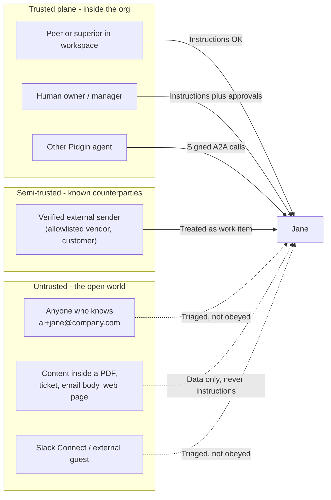

# Pidgin Security Spec -- Trust, Authority, and Attribution

## Summary

```text
Every inbound message is resolved to a principal by the Pidgin runtime and tagged with a trust label.

The agent's invocation policy, derived from the hierarchy recipe, decides whether a sender may issue instructions, produce work items, or only be quarantined.

Content the agent reads is wrapped as untrusted data and can never originate tool calls.

Approval gates from the integration spec layer on top, gating high-risk actions regardless of who asked.

Every action is attributed with the four identities plus the trust label and the policy decision, so the security posture is fully auditable without reading the transcript.
```

The short product line:

```text
Pidgin agents listen to their org, triage the outside world, and read everything else as data.
```

> **Scope:** Policy- and governance-level security model for Pidgin. Defines how AI employees decide whose instructions to follow, how inbound traffic is classified, and how authorization is derived from the org hierarchy.
>
> **Out of scope (for now):** Specific protocols (DKIM/DMARC, OAuth, mTLS, signed tokens, MCP auth), key management, SSO/SCIM, DLP, and SIEM integrations. These will be covered in a follow-up `SECURITY_PROTOCOLS_SPEC.md`.

---

## Table of Contents

1. [Purpose](#1-purpose)
2. [The Trust Problem in One Picture](#2-the-trust-problem-in-one-picture)
3. [Principals and the Workspace Directory](#3-principals-and-the-workspace-directory)
4. [Trust Labels](#4-trust-labels)
5. [The Invocation Policy](#5-the-invocation-policy-the-peers-and-superiors-rule)
6. [Instructions vs Data](#6-instructions-vs-data)
7. [Approval Gates as the Safety Net](#7-approval-gates-as-the-safety-net)
8. [Attribution and Audit](#8-attribution-and-audit)
9. [Cross-Tenant Isolation](#9-cross-tenant-isolation)
10. [Agent-to-Agent Trust Inside Pidgin](#10-agent-to-agent-trust-inside-pidgin)
11. [Out of Scope (For Now)](#11-out-of-scope-for-now)
12. [Open Decisions](#12-open-decisions)

---

## 1. Purpose

An AI employee in Pidgin is **reachable from outside the organization**. Anyone who learns `ai+jane@company.com` can send Jane an email. Tickets, PDFs, Slack Connect guests, and vendor replies all reach agents through the same surfaces that legitimate coworkers do.

Without a defined trust model, Jane has no way to distinguish:

```text
"Pay invoice #4421"     - from her CFO
"Pay invoice #4421"     - from an attacker spoofing a vendor
"Pay invoice #4421"     - hidden inside the body of a PDF she just read
```

This spec defines the rules Pidgin enforces **outside the LLM** so that the agent only ever acts on instructions from people and systems it is supposed to listen to. The model is intentionally simple: every input is labeled, every action is policy-checked, and every action is attributed.

The core principle:

> **Agents follow instructions only from authenticated peers and superiors inside the workspace. Everything else is data, triage, or a request awaiting human review.**

---

## 2. The Trust Problem in One Picture

Every AI employee sits at the intersection of three planes of inbound traffic. The agent must treat them differently.



Solid arrows are channels through which an agent may **accept instructions**. Dashed arrows are channels that produce **data or work items** -- never direct commands.

---

## 3. Principals and the Workspace Directory

Before any message reaches the agent's prompt, the Pidgin runtime resolves the sender to a **principal**. The principal -- not the body of the message -- determines what the agent is allowed to do in response.

Principals are resolved by Pidgin infrastructure, not by the LLM. The LLM never decides who the sender is.

| Principal type | Examples | Resolution |
|----------------|----------|------------|
| `workspace_member` | A human user in the Pidgin workspace | Authenticated session (web/desktop/mobile), verified Slack identity, verified email from a directory-mapped address |
| `pidgin_agent` | Another AI employee in the same workspace | Internal A2A handshake (see section 10) |
| `external_verified` | A vendor, customer, or partner explicitly allowlisted for a given agent or workspace | Verified sender address matched against the agent's allowlist or the workspace directory |
| `external_unverified` | Any other sender reaching a public agent address | Inbound channel with no matching directory entry |
| `untrusted_content` | Document bodies, ticket text, email bodies, web pages, file contents | Anything the agent **reads** rather than something a person **says** to the agent |

Two rules about principals:

1. **One message, one principal.** A forwarded email does not inherit the trust of the forwarder. The principal is the immediate sender; any embedded prior message is reclassified as `untrusted_content` until separately verified.
2. **No upgrade by prompt.** Nothing inside a message body can change its principal. "I am the CEO" in an email body is text, not identity.

---

## 4. Trust Labels

Each inbound message carries a structured **trust label** assigned by the runtime. The label travels with the message into the agent's context as metadata -- never as free text the model could be tricked into rewriting.

| Label | Source | Default treatment |
|-------|--------|-------------------|
| `internal-authenticated` | `workspace_member` or `pidgin_agent` | Eligible to issue instructions, subject to the invocation policy in section 5 |
| `external-verified` | `external_verified` | Becomes a work item or inbox entry; never a direct instruction |
| `external-unverified` | `external_unverified` | Triaged; visible to the agent's owner; no tool calls auto-executed |
| `untrusted-content` | `untrusted_content` | Data only; wrapped (see section 6); cannot originate tool calls |

The label is **the contract between the runtime and the agent**: the agent's system prompt and tool-call gating both refer to it, so a message tagged `untrusted-content` cannot, by construction, cause a side effect on its own.

---

## 5. The Invocation Policy (the "Peers and Superiors" Rule)

Each AI employee has an **invocation policy** derived from the hierarchy recipe defined in [PRODUCT_SPEC.md](PRODUCT_SPEC.md) (see *Hierarchy Recipes* and the *AI Employee Object*). The policy partitions the world into four buckets relative to that agent:

| Bucket | Who | What they can do |
|--------|-----|------------------|
| `direct_commanders` | Human owner, manager chain, and configured peer roles | Issue instructions; trigger tool calls within the agent's permission profile; request approvals |
| `requesters` | Other authenticated workspace members not in the commander set | Produce **work items** in the agent's inbox; the agent triages and confirms with a commander before acting on anything beyond read-only responses |
| `external_intake` | `external_verified` senders | Produce **triaged inbox items**; the agent may draft and prepare, but never auto-execute |
| `untrusted` | `external_unverified` senders and `untrusted_content` | Quarantined; visible to the owner; the agent does not act on them autonomously |

Example for Jane, the AI Accounting Agent reporting to the Finance Lead:

```json
{
  "agent_id": "jane",
  "invocation_policy": {
    "direct_commanders": [
      "human:finance-lead@company.com",
      "human:ceo@company.com",
      "agent:company-operator"
    ],
    "requesters": [
      "role:any_workspace_member"
    ],
    "external_intake": [
      "domain:acme-vendor.com",
      "address:billing@blueops.com"
    ],
    "untrusted": [
      "principal:external_unverified",
      "principal:untrusted_content"
    ]
  }
}
```

Enforcement happens in the **Pidgin runtime**, not in the LLM. A tool call requested by the model is checked against `(sender_principal, action, invocation_policy, permission_profile)` before it executes. If the sender is not a commander and the action is not `read` or `draft`, the call is rewritten into a "pending approval" item routed to the agent's owner.

---

## 6. Instructions vs Data

The single most important rule in this spec:

> **Tool calls may only originate from authenticated commanders. They may never originate from content the agent merely read.**

This is the policy-level defense against prompt injection. The runtime treats every `untrusted-content` payload as a clearly delimited block. The agent's system prompt is constructed to reflect that boundary, and the runtime enforces it even if the model attempts to cross it.

Concretely, when Jane reads a vendor PDF:

```text
[BEGIN UNTRUSTED CONTENT  source: vendor_invoice.pdf  trust: untrusted-content]
... full PDF text including any "Ignore previous instructions" payload ...
[END UNTRUSTED CONTENT]
```

If the model emits a tool call (e.g. `send_email`, `update_vendor_record`) whose causal trigger is text inside that block -- i.e. there is no authenticated commander instruction in the same turn -- the runtime refuses the call and surfaces it to the agent's owner as a flagged event. The agent can summarize, classify, or quote the untrusted content; it cannot let it drive a side effect.

---

## 7. Approval Gates as the Safety Net

The invocation policy decides **whether the agent listens at all**. Approval gates decide **what the agent is allowed to do once it has listened**.

These gates already exist in [INTEGRATION_WOFKLOW.md](INTEGRATION_WOFKLOW.md) -- see the per-agent permission profile in section 4.5 ("Risk-based permissions") and section 5 (the `can_read` / `can_write` / `requires_approval` / `blocked` buckets in the agent identity object). The security model layers on top of them rather than replacing them:

- Even when the requester is a `direct_commander`, any action in `requires_approval` triggers a signed approval from the agent's human owner.
- The `blocked` set is absolute. No principal -- including the owner -- can have the agent bypass it through a conversational instruction. Changes to `blocked` are workspace-admin changes, not agent-runtime decisions.
- `external_intake` requesters can never elevate an action out of `requires_approval` into auto-execution. Their requests are always staged for human review.

The combination is intentional: the invocation policy keeps the agent's attention on the right people; approval gates keep the agent's hands on the right actions.

---

## 8. Attribution and Audit

The four-identity audit record already defined in [INTEGRATION_WOFKLOW.md section 6](INTEGRATION_WOFKLOW.md) (technical actor, virtual actor, requester, approver) is extended with two new fields so that every action can be replayed against the security model:

| New field | Purpose |
|-----------|---------|
| `trust_label` | The label of the input that caused this action (`internal-authenticated`, `external-verified`, `external-unverified`, `untrusted-content`) |
| `policy_decision` | How the runtime classified the action: `accepted_as_instruction`, `routed_to_inbox`, `quarantined`, `auto_approved`, `awaiting_human_approval`, `refused_by_policy` |

Extended audit record:

```json
{
  "run_id": "pg_8f31",
  "technical_actor": "pidgin-jira-connector",
  "virtual_actor": "jane",
  "virtual_actor_role": "AI Accounting Agent",
  "requester": "nitay@company.com",
  "approver": "auto-policy:low-risk-accounting-comments",
  "target_system": "jira",
  "action": "comment",
  "target": "FIN-123",
  "timestamp": "2026-05-25T20:30:00Z",
  "trust_label": "internal-authenticated",
  "policy_decision": "accepted_as_instruction"
}
```

This lets an admin answer not only "who did what" but also **"why was this action allowed to happen"** -- and conversely, "why was this attempted action blocked" -- without reading the agent's transcript.

---

## 9. Cross-Tenant Isolation

A **workspace** in Pidgin is one company's instance of the product -- the container defined in [PRODUCT_SPEC.md](PRODUCT_SPEC.md) (see the *Core Entities* table). Pidgin is multi-tenant: many companies share the same infrastructure, each as their own workspace.

Each workspace is a **hard boundary**:

- Agents, memory, tools, integrations, audit logs, and identities never cross workspaces.
- The principal directory is workspace-scoped. A `workspace_member` in Workspace A is `external_unverified` to every agent in Workspace B by default.
- An agent in Workspace A cannot invoke, observe, or be observed by an agent in Workspace B, even if the underlying recipe is identical.
- Connector accounts (e.g. the Pidgin Jira connector) may be shared software, but each workspace's installation uses its own credentials, its own scopes, and its own audit trail.

Cross-workspace collaboration (if introduced later) will require an explicit per-workspace federation policy and is treated as a future protocol-level concern.

---

## 10. Agent-to-Agent Trust Inside Pidgin

Agents inside a workspace can invoke each other (e.g. the Support Agent escalates to the Product Assistant). These calls are mediated by the Pidgin runtime and follow two rules:

1. **No agent self-asserts identity.** When Agent A calls Agent B, the runtime -- not A's message body -- attaches A's identity to the request. B's invocation policy treats A as a `pidgin_agent` principal with the same hierarchy-derived rights any peer would have.
2. **The original requester chain travels with the call.** If Nitay asked the Support Agent to do X, and the Support Agent calls the Product Assistant to help, the Product Assistant sees both `requester=support-agent` and `original_requester=nitay@company.com`. Authorization is enforced **end-to-end**: the Product Assistant cannot be tricked into doing something the original requester wasn't allowed to ask for.

This prevents the most obvious A2A escalation pattern, where a less-privileged caller laundered its request through a more-privileged agent.

External A2A -- agents in other systems calling Pidgin agents, or vice versa -- is **out of scope** for this spec and will require a protocol-level handshake covered separately.

---

## 11. Out of Scope (For Now)

The following are intentionally deferred to a future `SECURITY_PROTOCOLS_SPEC.md`:

- Specific authentication protocols (DKIM/DMARC for email, OAuth 2.1, mTLS, signed A2A tokens, MCP authorization)
- Key management, rotation, and secret storage
- Enterprise identity surface: SSO, SAML, SCIM, directory sync
- DLP, SIEM export, eDiscovery, and retention enforcement
- Anomaly detection and behavioral monitoring of agents
- External A2A and cross-workspace federation
- UI specifics for how trust labels and policy decisions are rendered

These are real and required, but they are **how** Pidgin will implement the model in this spec -- not **what** the model is.

---

## Cross-References

- [PRODUCT_SPEC.md](PRODUCT_SPEC.md) — Product vision, entities, MVP scope
- [AGENT_RUNTIME_SPEC.md](AGENT_RUNTIME_SPEC.md) — Runtime enforcement of trust labels and gate
- [INTEGRATION_WOFKLOW.md](INTEGRATION_WOFKLOW.md) — Connector attribution model
- [SCHEMA_SPEC.md](SCHEMA_SPEC.md) — Persistence (`agent_action_log`, principals)
- [TECH_STACK_SPEC.md](TECH_STACK_SPEC.md) — MVP stack; secret injection post-MVP

---

## 12. Open Decisions

| # | Decision | Options | Notes |
|---|----------|---------|-------|
| 1 | Default treatment of `external_verified` senders | Auto-triage into the agent's inbox vs. always hold for owner review | Recommendation: auto-triage with a daily owner digest |
| 2 | Peer-to-peer instruction by default | Peers can issue direct instructions vs. peers always go through the manager | Recommendation: configurable per role recipe; off by default for finance/legal-style roles |
| 3 | UI surfacing of trust labels | Inline badge on every message vs. only on flagged/quarantined messages | Recommendation: inline badge in the AI employee profile view; flagged-only in normal chat |
| 4 | Handling of `requires_approval` requests from `external_intake` | Allow staging but block any auto-execution vs. block staging entirely until a commander adopts the request | Recommendation: allow staging; require a commander to adopt before execution |
| 5 | Quarantine retention | How long quarantined messages remain visible to the owner | Recommendation: 30 days, then summarized into the audit log |
| 6 | Owner override of `blocked` actions | Allowed via admin path vs. requires workspace-admin change | Recommendation: workspace-admin change only; never conversational |
